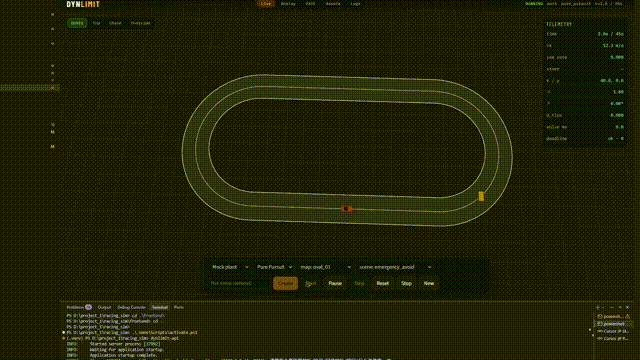
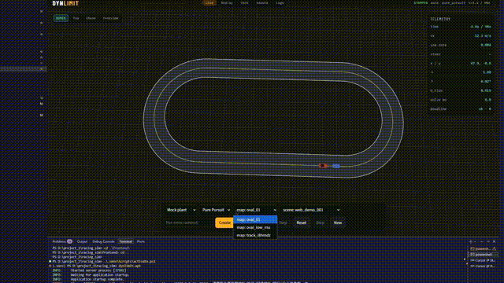
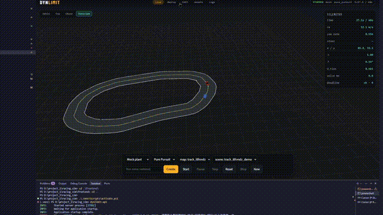
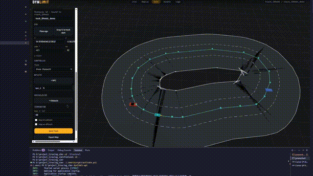
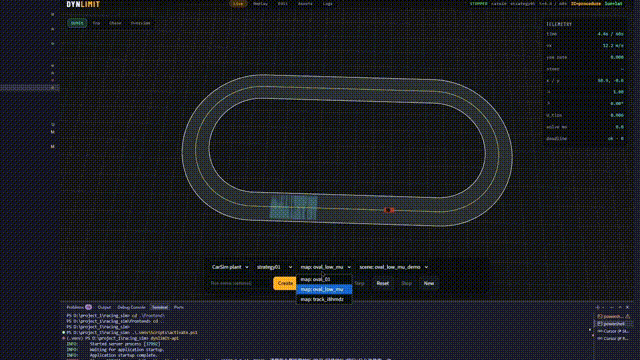
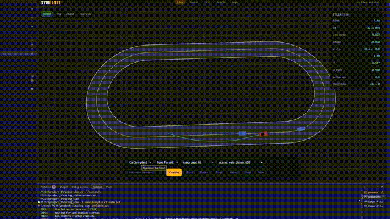

# DynLimit v0.1.1

[中文说明](README.zh-CN.md)

**DynLimit** (*Dynamics at the Limit*) is a vehicle-dynamics simulation and evaluation platform for physical limits and extreme driving:

- **Python** — simulation clock, planning/control, logging, HTTP API
- **Web UI** — Live / Replay / Edit / Assets
- **CarSim (optional)** — high-fidelity plant when you bring your own license and dataset

This folder is a **stable end-user snapshot**. Default workflow uses the **Mock** plant (no CarSim required).

### What’s new in v0.1.1

- Lane-local planning controllers: `lane_pp`, `lattice_pid_ml` (plus existing `lattice_pid` / `strategy01`)
- Demo assets: `4highway` track + `4highway_demo` scenario
- `carsim_db` configured via `dynlimit.toml` (`[paths].carsim_db`), with CLI/env overrides

## Demos

**1. A simulation run.** Choose a scenario, controller, and plant in **Live**, then start the loop and watch states and telemetry update together.



**2. Switching views.** Chase, orbit, and top-down cameras on the same run; the simulation keeps stepping while the view changes.



**3. Editing a scenario.** Add and drag track geometry in **Edit**, then save it back as a track or scenario asset.



**4. Attaching CarSim.** Select the CarSim plant and run the same controller through the external solver instead of the built-in model.



**5. Replay management.** Browse the stored experiments in **Replay**, open one record, and step through it.



**6. Replaying a CarSim run.** Replay a record written by the CarSim plant; no solver is needed to review it.



## Requirements

- Python ≥ 3.10
- Node.js + npm (for the Web UI)
- Optional: Mechanical Simulation CarSim license, a local `carsim_db`, and an importable `pycarsimlib`

## Quick start (Mock)

From this directory (`opensource/v0.1.1/`):

```powershell
# 1) Python env
python -m venv .venv
.\.venv\Scripts\activate
python -m pip install -U pip
python -m pip install -e .

# 2) Frontend deps (first time)
cd frontend
npm install
cd ..
```

**Terminal 1 — API**

```powershell
.\.venv\Scripts\activate
dynlimit-api
# or: python -m backend.app.main
```

- API: http://127.0.0.1:8000  
- OpenAPI: http://127.0.0.1:8000/docs

**Terminal 2 — UI**

```powershell
cd frontend
npm run dev
```

Open **http://127.0.0.1:5173** (use the Vite URL, not port 8000).

In **Live**: pick a demo scenario (e.g. `web_demo_001` or `4highway_demo`) → Create → Start with Mock.

## UI tabs

| Tab | Purpose |
|---|---|
| **Live** | Create/start a session; choose controller and plant |
| **Replay** | Replay recorded experiments (no CarSim needed) |
| **Edit** | Edit track/scenario geometry and NPCs |
| **Assets** | List / open / delete tracks and scenarios |

Demo configs live under `configs/tracks/` and `configs/scenarios/`.

## CLI (Mock)

```powershell
.\.venv\Scripts\activate

dynlimit --plant mock --steering 0.05 --throttle 0.3

dynlimit run --plant mock --scenario-id web_demo_001 --duration 20 --display-name demo_01
```

Results are written under `data/experiments/<id>/`.

## Config / data / CarSim paths

Defaults ship in `dynlimit.toml` next to this snapshot:

```toml
[paths]
config_root = "configs"
data_root = "data"
carsim_db = "carsim_db"   # absolute path OK, e.g. "D:/Carsim/db"
```

Override priority (high → low):

1. CLI: `--config-root` / `--data-root` / `--carsim-db` / `--toml`
2. Env: `DYNLIMIT_CONFIG_ROOT`, `DYNLIMIT_DATA_ROOT`, `DYNLIMIT_CARSIM_DB`, `DYNLIMIT_TOML`
3. `dynlimit.toml` `[paths]`
4. `./configs`, `./data`, `./carsim_db`

`GET /api/health` echoes the resolved roots. API port: `DYNLIMIT_API_PORT` (default `8000`). Frontend proxy: `DYNLIMIT_API_PROXY`.

## Optional: CarSim

This snapshot **does not** ship CarSim databases or `pycarsimlib`.

If you already have a licensed CarSim install:

1. Set `carsim_db` in `dynlimit.toml` (directory containing `simfile.sim`).
2. Ensure `pycarsimlib` is importable (install/vendor it yourself).
3. Run with `--plant carsim` / API `"plant": "carsim"`.

Third-party CarSim licensing and redistribution terms are your responsibility.

## License

MIT — see [LICENSE](LICENSE).

## Disclaimer

Provided for research and education. No warranty. You are responsible for compliance with any third-party software licenses (including CarSim).
